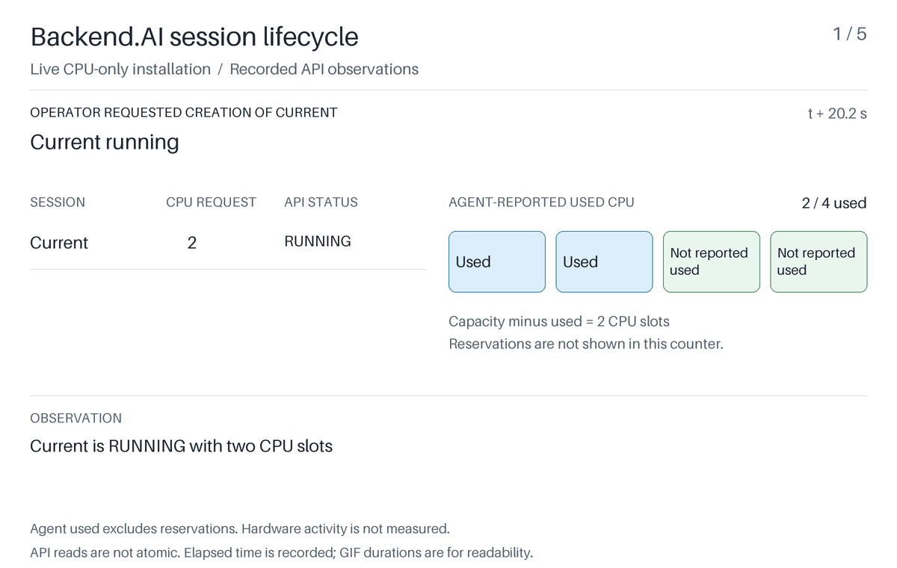

# Backend.AI queue order and resource release

This experiment runs Backend.AI 26.9.7 locally with a four-CPU worker. It submits three ordinary interactive sessions, records the public API responses and scheduling history, and draws a GIF from the saved JSON. GPUs are not required.

The current session holds two CPU slots. Alice requests four, followed by Bob's request for one. The FIFO scheduling pass cannot place Alice and skips Bob, even though Bob's request would fit. After the current session ends, Alice starts. After Alice ends, Bob starts.



The [saved recording](recordings/macos-arm64/recording.json) and [static storyboard](recordings/macos-arm64/storyboard.png) come from a local macOS ARM64 run. The JSON includes the observed checks and cleanup result. Exact elapsed times vary between machines and runs.

Alice and Bob are workload labels. The live experiment submits all three sessions through one generated administrator account. Quotas are sufficient, and the sessions do not perform a CPU benchmark. The squares in the visualization represent resource accounting, not measured CPU activity.

## Reproduce the live experiment

Requirements:

- macOS or Linux, with Git and Docker Compose available.
- A running local Docker engine accessed through a Unix socket, with at least four CPUs. On macOS, start Docker Desktop first. Remote Docker endpoints are not supported.
- Approximately 6 GB of free disk space for Python packages, images, and runtime data. The workload image download is approximately 750 MB compressed.
- Network access to GitHub, PyPI, Docker Hub, Quay, and `cr.backend.ai` for the first run.
- [uv 0.13.7](https://docs.astral.sh/uv/getting-started/installation/) or a compatible newer version. The Python version is selected by `.python-version`.

```sh
git clone https://github.com/yongkyunlee/code-pointer-demo.git
cd code-pointer-demo/2026-11-backend-ai-intro
uv sync --locked
uv run --locked python run.py
```

`run.py` creates isolated PostgreSQL, Valkey, and etcd containers, initializes Backend.AI from the pinned upstream fixtures, starts its manager, agent, and storage proxy, and performs the experiment. It terminates its own sessions and stops its own services afterward. It removes the experiment's database volumes; downloaded images remain cached for another run.

If API termination fails, cleanup resolves this run's exact session names and IDs and checks their Docker labels before removing remaining workload containers. If ownership or removal cannot be verified, it preserves the infrastructure and database for recovery. A lock prevents concurrent runs in the same checkout.

Generated credentials, service logs, configuration, and the upstream source cache stay under the ignored `.runtime/` directory. Services listen on loopback. The setup does not modify shell profiles, the Docker configuration, or an existing Backend.AI installation. Use an otherwise idle local Docker engine for the experiment.

The default output is `artifacts/live/`:

- `recording.json` contains observed API samples, operator actions, scheduling history, checkpoints, checks, and cleanup results. Partial evidence is saved if a stage fails.
- `scheduler.gif`, `storyboard.png`, and `keyframe.png` are derived from selected samples in that recording.
- `manifest.json` records the source JSON hash and the generated artifact hashes.
- `run-status.json` records whether the complete run succeeded, including setup and rendering. `environment-cleanup.json` records the workload-container and infrastructure cleanup outcome when cleanup was attempted.

Every stage has a timeout. A failed prerequisite, unexpected scheduler response, unsuccessful startup, or incomplete cleanup causes a nonzero exit. A new run replaces the known generated files in its output directory, so failed attempts cannot leave an earlier successful GIF beside new evidence. Use a different `--output` directory to retain previous runs. Inspect `run-status.json`, any partial recording and cleanup report, and `.runtime/logs/` when a run fails. These logs are private runtime diagnostics and are not intended for publication.

## Replay a recording

Rendering does not need Docker or an active Backend.AI installation:

```sh
uv run --locked backend-ai-intro render artifacts/live/recording.json --output artifacts/replay
```

To replay the committed reference, replace the input path with `recordings/macos-arm64/recording.json`.

The renderer selects actual recorded checkpoints. It does not invent startup states or convert successful placement into a claim that a container ran. GIF playback uses fixed presentation durations; displayed elapsed times come from the recording.

Session and agent API queries are sequential, so a sample is not an atomic database snapshot. The agent's `occupied_slots` field reports used resources; reservations can exist before that count changes. The experiment checks stable running states and keeps the original observations for inspection.

## Smaller scheduler experiment

A separate component experiment runs Backend.AI's real quota validator, FIFO sequencer, placement selector, and provisioner directly. It requires Python dependencies but no Docker, database, or GPU:

```sh
uv run --locked backend-ai-intro component --output artifacts/component
```

Its inventory and release snapshots are synthetic. Explicit in-memory adapters replace persistence and queue storage. Its output establishes scheduling decisions, not container startup or actual lifecycle recovery. Controls put Bob first, reject Alice by quota, and repeat a scheduling pass without changing capacity.

## Verification and pins

```sh
uv run --locked ruff check .
uv run --locked ruff format --check .
uv run --locked pytest
```

Backend.AI packages are pinned to `26.9.7`; upstream configuration and fixtures come from commit `332a308e34c5c7bcd57939850fe032cfd8d8ca00`. Python is pinned to `3.13.18`. `uv.lock` locks transitive dependencies and distribution hashes. Infrastructure images use manifest digests. Workload image digests are listed in `images.json`. Pillow supplies the font, so rendering does not depend on system fonts.

Image registration still reads the upstream version tag and verifies its metadata against the pinned digest. If that tag is changed or removed, setup stops instead of running different image contents. First-time reproduction also depends on the listed package and image registries remaining available.

The setup converts the pinned example fixture's `shared_memory` strings to integers for its BIGINT database field. This adjusts input formatting and does not modify the upstream scheduler.

The live check requires Alice to pass policy validation and fail placement with a two-CPU shortfall. Bob must be skipped behind Alice in the same FIFO pass while Current remains running. Normal release checks require `TERMINATED`; a session entering `ERROR` fails the experiment.

The tests exercise real scheduling decisions in the component experiment and cover recording validation, rendering, timeout handling, credential redaction, cleanup ownership, and failed reruns at the live API boundary. A successful test suite does not substitute for the live run.

## Source layout

- `run.py` supervises the complete local run and infrastructure cleanup.
- `runtime_setup.py` prepares private configuration and verifies the bootstrapped database.
- `src/backend_ai_intro/live.py` submits sessions and records actual API observations.
- `src/backend_ai_intro/experiment.py` and `upstream_adapter.py` implement the component experiment.
- `src/backend_ai_intro/render.py` renders saved recordings.
- `tests/` checks behavior and failure handling.

The demo code is MIT licensed. Backend.AI and the other installed dependencies retain their own licenses. Upstream source and generated runtime fixtures are downloaded separately and are not included in this repository.
