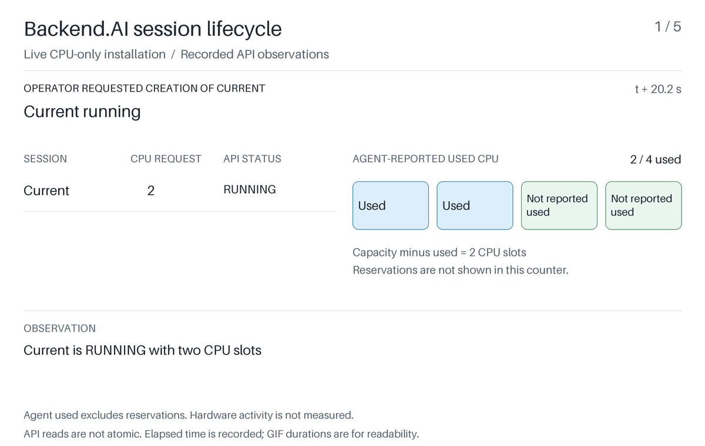

# FIFO queue order and resource release

Current holds two of a worker's four CPU slots. Alice requests four slots, then Bob requests one. FIFO keeps Bob waiting behind Alice even though Bob's request fits. The runner ends Current, waits for Alice to start, then ends Alice and observes Bob starting.

This is a live Backend.AI 26.9.7 installation with real session containers. Alice, Bob, and Current are session labels submitted through one generated account. Resource accounting is observed through the API; CPU activity is not benchmarked. Session termination is requested by the runner.

From the shared project directory:

```sh
uv sync --locked
uv run --locked python experiments/01-fifo-queue/run.py
```

The [shared setup instructions](../../README.md) describe Docker prerequisites, the isolated runtime, ownership checks, and cleanup. New output is saved under `artifacts/live/` in this experiment directory. The existing root `run.py` command remains available.

## Recorded evidence

The original [macOS ARM64 recording](recordings/macos-arm64/recording.json) is retained unchanged. Its [manifest](recordings/macos-arm64/manifest.json) binds the visualization to the saved evidence. These files predate the later runner validation fixes; the original evidence passes the strengthened checks.



Replay the reference from the shared project directory:

```sh
uv run --locked backend-ai-intro render experiments/01-fifo-queue/recordings/macos-arm64/recording.json --output experiments/01-fifo-queue/artifacts/replay
```

The CPU component version remains available through `backend-ai-intro component`. It exercises the upstream provisioner with synthetic state and is separate from the live recording.

## Review rerun

The [November 5 review rerun](recordings/macos-arm64-review-20261105/) passed the strengthened FIFO and cleanup checks with 45 samples. The original recording remains available.
