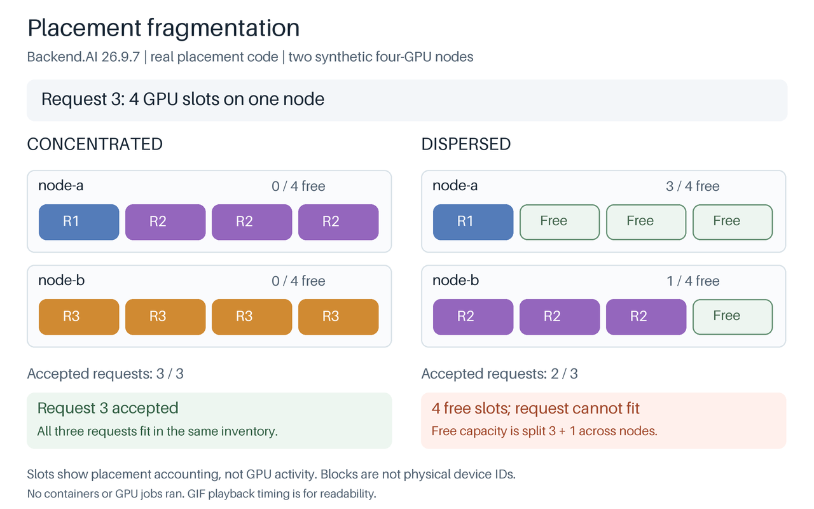

# Placement fragmentation

**Four free GPU slots cannot satisfy a four-GPU request when that request must fit on one node and the free slots are split across nodes.** This experiment compares Backend.AI's `CONCENTRATED` and `DISPERSED` placement strategies on exactly the same requests and inventory.

The experiment runs the actual installed Backend.AI `26.9.7` selector factory, filters, placement strategies and allocation trackers. The two four-GPU node inventories are synthetic. It does not start Backend.AI services, containers or GPU workloads.



## Run

From `2026-11-backend-ai-intro/`, use the existing project environment.

```sh
uv sync --locked
uv run --locked python experiments/02-placement-fragmentation/run.py
```

Python must be `>=3.13.18,<3.14`. The installed `backend.ai-manager` and `backend.ai-common` packages must be exactly `26.9.7`. The script checks their versions and verifies the loaded placement source against the installed wheels' `RECORD` hashes. It exits with a nonzero status if a required outcome, control or accounting check fails. Checks remain enabled under Python's `-O` option.

The runner writes `artifacts/latest/recording.json` inside this experiment's directory, reloads that JSON and generates the images beside it. The checked-in `recordings/` directory remains unchanged. The experiment requires neither a GPU nor Docker. Initial dependency installation requires network access; the component experiment itself does not.

To replay the saved observations without invoking Backend.AI's placement code:

```sh
uv run --locked python experiments/02-placement-fragmentation/run.py \
  --recording experiments/02-placement-fragmentation/recordings/recording.json \
  --render-dir /tmp/backend-ai-fragmentation-replay
```

To choose another output directory:

```sh
uv run --locked python experiments/02-placement-fragmentation/run.py \
  --output /tmp/backend-ai-fragmentation/recording.json \
  --render-dir /tmp/backend-ai-fragmentation
```

Updating the reference recording is explicit:

```sh
uv run --locked python experiments/02-placement-fragmentation/run.py \
  --output experiments/02-placement-fragmentation/recordings/recording.json \
  --render-dir experiments/02-placement-fragmentation/recordings
```

A rerun clears its previous generated figures and manifest before recording or validating results. A failed component run also removes the previous recording at its requested output path. Replay preserves the input JSON. Files unrelated to this experiment's output filenames are left alone.

## Inputs and observed results

Each node begins with four free `cuda.device` slots. Three independent requests arrive in the fixed order **1, 3, 4**. Each request has a single placement requirement, so its slots must fit together on one node. Successful placements remain allocated for the following requests.

| Request | Concentrated placement | Free slots afterward | Dispersed placement | Free slots afterward |
|---|---|---|---|---|
| 1 slot | node-a | 3, 4 | node-a | 3, 4 |
| 3 slots | node-a | 0, 4 | node-b | 3, 1 |
| 4 slots on one node | node-b | 0, 0 | Cannot place | 3, 1 |

The third dispersed placement records a `resource` filter failure with a one-slot shortfall on the best candidate. The failed request leaves the inventory unchanged. The runner checks the selected node, the change in free slots and the failure evidence, rather than accepting a success flag alone.

Two controls are included in the saved JSON:

- Reversing the node input order preserves the difference in which requests fit. Node names may change because the first choice begins with equal inventories.
- Moving the largest request first, giving **4, 1, 3**, lets every request fit under either strategy. The original sequence favors concentration; the result does not make concentration universally better.

`DISPERSED` is the resource group's default placement strategy at this release. Switching to `CONCENTRATED` affects new placement decisions; it does not migrate existing workloads to repair fragmentation.

The fixture uses matching `x86_64` architecture metadata, zero initial usage and reservations, and no container limit, designated node, session group or preemption candidates. CPU and memory resource dimensions are omitted to isolate GPU placement. The factory includes filters for other constraints, but this fixture does not exercise their rejecting branches.

## Recorded artifacts

- [recording.json](recordings/recording.json) contains every request, selected node, before/after inventory, failure and control result. Schema version is `1`; experiment mode is `component_synthetic_gpu`.
- [placement.gif](recordings/placement.gif) replays the initial inventory and three observed placement outcomes side by side.
- [comparison.png](recordings/comparison.png) shows the final inventory.
- [storyboard.png](recordings/storyboard.png) contains every frame.
- [manifest.json](recordings/manifest.json) binds the recording and generated figures with SHA-256 hashes and records the renderer's source hash.

The recording includes Python and package versions, platform, the harness and dependency-lock hashes, and hashes of the loaded placement source modules. Release tag `26.9.7` resolves to source commit `332a308e34c5c7bcd57939850fe032cfd8d8ca00`; this is a source reference, not a claim that the wheel embeds that commit. The recorded run used Python `3.13.18` on macOS ARM64.

The colored blocks label accepted requests, not physical GPU device IDs. GIF durations are chosen for readability and contain no measured scheduling or workload times. Rendering validates the recording and does not run a second placement algorithm.

## Scope

The observed result establishes a placement difference under these inputs. It does not measure GPU activity, workload throughput, cost savings or a feature exclusive to Backend.AI. Accepted placement means the component found capacity, not that a container or training job ran.

The runner bypasses queue admission, quotas, database persistence, lifecycle coordination, agent RPC, image preparation and CUDA execution. The existing FIFO experiment covers a different boundary, using a real CPU deployment to record queue order and resource release.

## Implementation and verification

The local harness is [fragmentation.py](../../src/backend_ai_intro/fragmentation.py). It imports `create_agent_selector()` and invokes `AgentSelector.compute_placements()` directly; it does not copy or replace the upstream selection algorithm. [fragmentation_render.py](../../src/backend_ai_intro/fragmentation_render.py) draws the saved observations. [test_fragmentation.py](../../tests/test_fragmentation.py) exercises the actual installed selector and rejects altered accounting, missing controls and unsupported outcomes before rendering.

```sh
uv run --locked pytest tests/test_fragmentation.py -q
```

The upstream source entry points are [pool.py](https://github.com/lablup/backend.ai/blob/332a308e34c5c7bcd57939850fe032cfd8d8ca00/src/ai/backend/manager/sokovan/scheduler/provisioner/selectors/pool.py), [selector.py](https://github.com/lablup/backend.ai/blob/332a308e34c5c7bcd57939850fe032cfd8d8ca00/src/ai/backend/manager/sokovan/scheduler/provisioner/selectors/selector.py), [concentrated.py](https://github.com/lablup/backend.ai/blob/332a308e34c5c7bcd57939850fe032cfd8d8ca00/src/ai/backend/manager/sokovan/scheduler/provisioner/selectors/concentrated.py), [dispersed.py](https://github.com/lablup/backend.ai/blob/332a308e34c5c7bcd57939850fe032cfd8d8ca00/src/ai/backend/manager/sokovan/scheduler/provisioner/selectors/dispersed.py) and [tracker.py](https://github.com/lablup/backend.ai/blob/332a308e34c5c7bcd57939850fe032cfd8d8ca00/src/ai/backend/manager/sokovan/scheduler/provisioner/selectors/tracker.py).
