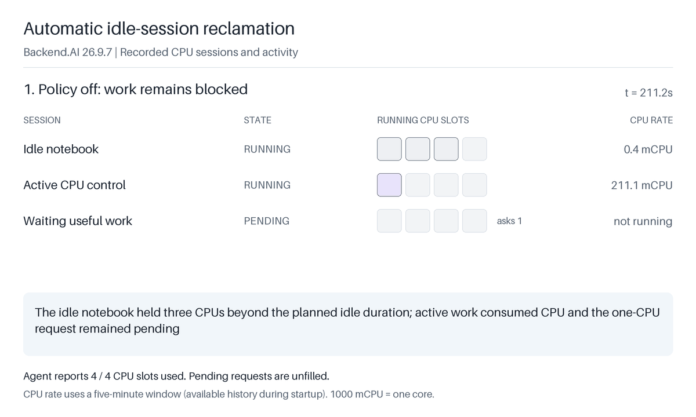

# Idle reclamation and saved work

This experiment uses a real Backend.AI 26.9.7 manager, CPU agent, containers,
storage proxy, and Prometheus. It measures CPU activity, applies an actual
utilization policy, and checks a file from a new session after idle termination.

The [recorded macOS ARM64 run](recordings/macos-arm64/recording.json) passed all
scenario and cleanup checks. It contains 273 API samples. The idle session ended
automatically, the waiting job ran, the active control survived, and a fresh
session read the saved file with its original SHA-256.



```sh
uv run --locked python experiments/03-idle-reclamation/run.py --help
uv run --locked python experiments/03-idle-reclamation/run.py
```

The default output is this experiment's `artifacts/live/` directory. Replay the
reference without Docker, from the shared project directory:

```sh
uv run --locked backend-ai-intro render experiments/03-idle-reclamation/recordings/macos-arm64/recording.json --output experiments/03-idle-reclamation/artifacts/replay
```

The shared supervisor creates an isolated runtime, starts the required services,
records the run, and cleans up its own resources. See the root README for Python,
Docker, source pin, and image prerequisites. Prometheus is pinned by digest. Its
configuration scrapes the actual agent every two seconds. Docker Desktop uses
`host.docker.internal` to reach the local agent listener. Live setup requires macOS ARM64.

The agent has four CPU slots. An idle notebook reserves three and saves a file in
a vfolder. An active control reserves one and runs a bounded CPU computation in
its container. A third session requests one CPU and waits. All workload roles use
one generated administrator account with sufficient quota.

The runner first observes at least 75 seconds without an attached idle policy.
It records low measured CPU usage by the notebook, high usage by the active
control, and the waiting session's pending state. Creating the policy alone does
not attach it to sessions.

Next, the runner includes only the notebook and active control in a utilization
checker. The checker uses the seeded five-minute rate Prometheus preset with
`container_metric_name=cpu_used` and `value_type=current`. The agent exports
cumulative CPU milliseconds, so the per-second rate has units of millicores.
The recorded metric query uses the same rate and window as the policy. CPU usage below 100
millicores for the configured 60-second duration qualifies as idle. Periodic
reconciliation and polling add delay, so the experiment does not expect exactly
60 seconds to termination. Missing measurements do not count as zero usage.

The measured stage requires the notebook to end with `idle-timeout`, release its
allocation, and allow the waiting job to run. The active control must still be
running above the same CPU threshold. The current runner also checks that the actual CPU worker process is still alive before policy attachment and after reclamation, because a five-minute CPU rate can remain high after a worker exits. The runner does not terminate the notebook
during that stage. The waiting job computes a checked SHA-256 result. A new
session mounts the same vfolder and reads the saved file; its SHA-256 must match
the value recorded before reclamation.

The recording contains API samples, real CPU metrics, scheduling history, policy
configuration, operator actions, workload output, and cleanup results. Timings
describe the recorded run. Samples combine sequential API requests and are not
atomic snapshots. The runner deletes only its own checker, sessions, and vfolder. Vfolder cleanup moves the folder to trash, requests physical deletion, waits for the manager to report `delete-complete`, and only then purges the database record. The storage proxy stays running until deletion completes. Failed runs and incomplete infrastructure cleanup cannot be replayed as verified idle evidence.

The original checked-in reference predates these additional process and physical-deletion checks. Its cleanup moved the folder to trash; it did not prove that the saved file had been deleted. The [review rerun](recordings/macos-arm64-review-20261105/) records the added checks, including completed physical deletion, with 248 samples and waiting work observed running 110.389 seconds after policy attachment.

At the pinned release, the Prometheus path in
[`stats.py`](https://github.com/lablup/backend.ai/blob/26.9.7/src/ai/backend/agent/stats.py)
exports each raw measurement before applying the internal `Metric.current_hook`.
The CPU plugin supplies cumulative milliseconds for `cpu_used` and `cpu_util`.
The experiment therefore uses the explicitly cumulative `cpu_used` metric with
the existing rate preset, rather than treating `cpu_util/current` as instantaneous
CPU usage. Docker API sampling can be delayed; the runner waits for actual
active/idle observations and does not replace missing data with zeros.

This is a CPU demonstration of automatic allocation recovery and persistent saved
files. It does not measure GPU throughput, memory isolation, or financial savings.
The session ends, so unsaved process memory does not survive. Network inactivity
and fixed session lifetimes are not used as substitutes for utilization.
